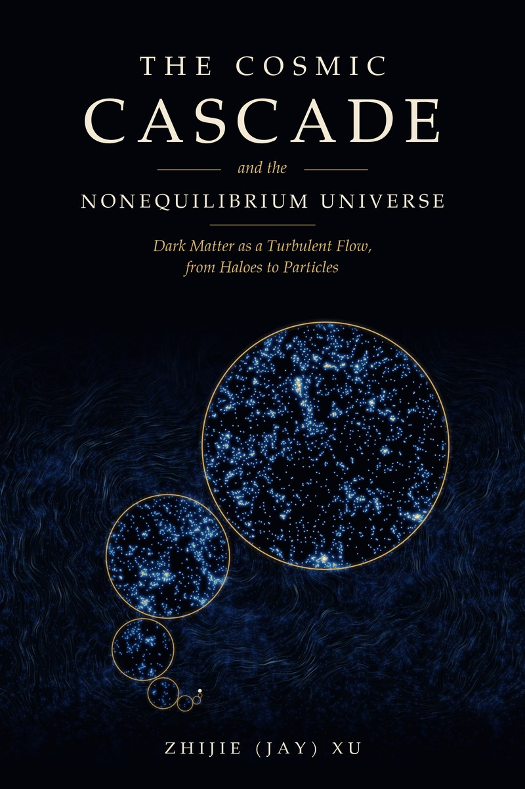

# The Cosmic Cascade and the Nonequilibrium Universe

**Dark Matter as a Turbulent Flow, from Haloes to Particles**

Zhijie (Jay) Xu — book in preparation (draft, November 2026)

A stirred fluid, a universe of dark matter and a neural network in training never settle. Each is driven, couples its scales, fluctuates and keeps what it has built, and each shows power laws that end at a scale which moves with time. This book studies the second of these systems with the questions of the first, and ends by setting the third beside them.

This repository gives an overview of the book: its cover, table of contents and preface, the plan of the whole book, and the research papers, data and code it is built on. The full text is under review by the author and is not yet released.

## About the book

The title names two things. **The cascade is the subject:** the transfer of mass from small haloes of dark matter to large ones, and of total energy the other way. **Nonequilibrium is the frame.**

Leave a gas in a closed box and it comes to equilibrium: collisions share out the energy, the velocities settle into Maxwell's distribution, and nothing flows any more. Dark matter never gets there, for three reasons. Its force, gravity, is long-range and cannot be screened, so the whole cannot be built from local equilibria. Its background expands, so the laws that move the particles change with time and the energy of the particles is not conserved. And matter keeps arriving: haloes keep accreting and merging. The result is a flow with many scales and no small parameter, held away from equilibrium by a steady transfer across scales — the kind of system that the theory of turbulence is about.

The book is a research monograph written from the side of fluid dynamics. It asks the questions of turbulence of the dark-matter flow and answers them with measurements in cosmological simulations, exact relations and models stated as such. It brings together, rewrites and recomputes the results of 24 papers published or posted by the author between 2020 and 2026, in one logical order with one notation, one set of conventions and one registry of numbers. It is not a collection of the papers. Two primer chapters, one on structure formation for readers from fluid dynamics and one on turbulence for readers from cosmology, make it readable from either side.

## Three systems out of equilibrium

The book reads each system with the same four ingredients of a driven system with many scales.

| | Turbulence | Dark matter | Training a language model |
|---|---|---|---|
| **Drive** | stirring puts energy in at the largest scale | matter keeps entering haloes; the binding of the largest haloes deepens as they grow | the stream of training data |
| **Coupling across scales** | advection hands energy from an eddy to smaller eddies | accretion and mergers pass mass to larger haloes and total energy to smaller ones | the nonlinear layers couple what is learned at one length of context to what is learned at another |
| **Fluctuations** | the instability of each eddy | the primordial density field, then the random sequence of accretions and mergers | sampling of the data in small batches |
| **End of the chain** | viscosity turns the motion of the smallest eddies into heat | the expansion removes total energy, and no heat is made; the binding of matter into haloes makes structure permanent | what has been learned is consolidated and stays |
| **Variable of scale** | wavenumber | halo mass; radius inside a halo | length of context |
| **Law with a moving cut-off** | Kolmogorov spectrum with its dissipation range | halo mass function, cut off at a mass that grows with time; density inside haloes | loss spectrum, whose scales move with training |

In each system the law is the solution of one random walk in a variable of scale, with a waiting time that is a power of the scale. For turbulence and dark matter the four ingredients are shown in the chapters; for language models they are a reading of training, not a measurement.

### The dark-matter cascade

Turbulence in three dimensions carries one quantity, kinetic energy, from large eddies to small ones, where viscosity turns it into heat. Dark matter carries two quantities in opposite directions. **Mass** enters at the small end, where free particles join haloes, is passed up by accretion and mergers, and piles up near a cut-off mass that grows with time, as energy does in two-dimensional turbulence. **Total energy**, kinetic plus potential, flows down from the binding of the largest haloes to the smallest scale, as energy does in three-dimensional turbulence. The sink is not viscosity but the expansion of the universe, which makes no heat, and the reservoir is a gravitational well without a floor.

### The language-model part

The last part of the book applies the same frame to a system with no physics in it. A language model is allowed to see only the last *r* tokens of a text, and its loss is measured as a function of *r* and of the training step. The gain in loss per added token of context, the *loss spectrum*, plays the part of the energy spectrum of turbulence.

- **Measured.** For four public models (Pythia with 70, 160 and 410 million parameters, and GPT-2), on WikiText-103, the loss spectrum falls as a power of the length of context, with slopes between −1.05 and −1.21 for *r* = 2 to 32. Training has two phases: for Pythia-160M, the part of the loss that context removes grows quickly until about step 1.9 × 10³, where it equals the loss with full context; after that both change slowly.
- **Modelled.** Learning to use context is taken to be a random walk in the length of context. A closure from Heaps' law for the number of distinct words gives a waiting-time exponent of 1/6. The walk then gives a loss spectrum of *r*^−7/6, inside the measured range, and a loss with full context that falls as the tenth root of the number of training steps. Pythia-160M shows an exponent of −0.101 between steps 2000 and 10⁴, flatter later; across model sizes the exponent ranges from −0.07 to −0.16.
- **What the analogy carries, and what it does not.** The three systems share scale-free random transport with a moving cut-off. The exponent, the direction and the drift come from each system's own closure, source and noise. The loss is not a conserved quantity, and language models have no equation of motion of the kind that turbulence and dark matter have. The evidence spans one decade of context, one corpus, one family of models and GPT-2. The book labels this part as frontier, an analogy, not a result of the core.

## Major findings

- **Dark matter is a flow out of equilibrium with two cascades.** Mass passes from small haloes to large ones, and total energy from large scales to small; the expansion is the sink and makes no heat. In the Virgo run both flows keep their direction at every output since redshift 3.
- **One measured rate is the thread of the book.** The kinetic energy of the motion of particles inside their haloes grows nearly in proportion to cosmic time (as t^0.92 in the Virgo run, with exponents 0.99 to 1.07 in Illustris-1-Dark). The constant of proportionality, the cascade rate, is about 3 × 10⁻⁷ m² s⁻³ (3.0 × 10⁻⁷ and 2.6 × 10⁻⁷ in the two runs).
- **The flow keeps a memory at both ends and forgets in between.** Its laws hold only in a range where gravity has erased the initial conditions; quantities inside haloes agree between two simulations with different initial spectra and expansion histories, while those set by the initial spectrum do not.
- **The statistics of the flow obey exact kinematic relations.** The flow is of constant divergence inside haloes and irrotational on large scales. Its velocity distributions are non-Gaussian for an identifiable reason, and a maximum-entropy argument gives their form.
- **Haloes are built by random walks.** A random walk of halo mass gives the shape of the halo mass function, with the Press–Schechter form as a special case. A rate of energy transfer that is the same at every radius gives the four-thirds law of the density over part of halo interiors and the two-thirds law of the velocity dispersion with halo mass.
- **The cascade reaches observations.** The same rate is carried to rotation curves and an acceleration scale, the baryon content of haloes, supermassive black holes and cosmic quenching, the decline of cosmic star formation, and a dark-energy model fitted to DESI DR2, each application with hypotheses of its own.
- **At the frontier the rate reaches the particle.** Labelled as an extrapolation over some thirty decades in length, the cascade fixes a dark-matter particle mass near 10¹² GeV to within a factor of two.
- **One random walk, three systems.** The same random walk in a variable of scale describes the spectrum of turbulence, the haloes of dark matter and the loss spectrum of language models in training. For four public language models the loss spectrum falls as a power of the length of context, with slopes from −1.05 to −1.21; the walk predicts −7/6.
- **Every claim carries its standing.** Every key result is labelled *measured*, *derived* or *assumed*, and the last chapter sorts all the claims of the book under these labels.

## Contents

**Front matter:** Preface

**Part I — The idea and the tools**

1. Dark matter as a flow out of equilibrium
2. Structure formation in brief
3. What turbulence teaches
4. The numerical universe

**Part II — Statistics of the flow**

5. Velocity correlations, structure functions and spectra
6. Higher orders and the dynamics of correlations
7. How velocities and densities are distributed
8. Maximum entropy and the X distribution

**Part III — The cascade**

9. Energy in an expanding universe
10. Two bodies in an expanding universe
11. The inverse mass and energy cascade

**Part IV — Haloes**

12. Halo mass functions
13. Halo density profiles
14. Growing, rotating, deforming haloes

**Part V — From the dark flow to the visible universe**

15. Rotation curves and the critical acceleration
16. How many baryons a halo keeps
17. Supermassive black holes and cosmic quenching
18. Cosmic star formation, the first galaxies and early black holes
19. Dark energy from structure formation

**Part VI — What is dark matter made of?**

20. From halo to particle
21. Superheavy dark matter and the first microseconds

**Part VII — Beyond the dark universe**

22. One random walk, three systems (turbulence, dark-matter haloes and the training of language models)
23. Established, assumed, open

**Appendices:** A. Notation, units and constants · B. Mathematical supplement · C. Data, code and reproducibility · D. Relation to the original papers · Glossary · Bibliography · Index

Parts I to IV are the core (measurements in simulations and derivations); Part V holds the applications (models compared with observations); Parts VI and VII are the frontier (extrapolations and analogies).

## Files

| Path | Content |
|---|---|
| `The_Cosmic_Cascade_cover_contents_preface.pdf` | Cover, title page, table of contents and Preface, with the bibliography pages that list the entries the Preface cites (12 pages, from the draft of 21 November 2026) |
| `cover.jpg` | Front cover |
| `social_preview.png` | Cover image sized for the GitHub social preview (1280 × 640) |
| `CITATION.cff` | Citation metadata |
| `LICENSE` | Terms of use |

The PDF is cut from the compiled draft without changes; links inside it are removed. Its text may change before release.

## Papers behind the book

| Paper (data and code repository) | Published as / posted at | Chapters |
|---|---|---|
| [On the statistical theory of self-gravitating collisionless dark matter flow](https://github.com/ZhijieXu2022/On-the-statistical-theory-of-self-gravitating-collisionless-dark-matter-flow) | Phys. Fluids 35, 077105 (2023), [doi:10.1063/5.0151129](https://doi.org/10.1063/5.0151129) | 1, 4, 5 |
| [On the statistical theory of self-gravitating collisionless dark matter flow: High order kinematic and dynamic relations](https://github.com/ZhijieXu2022/On-the-statistical-theory-high-order-kinematic-dynamic-relations-dark-matter-flow) | Phys. Fluids 36, 075146 (2024), [doi:10.1063/5.0215026](https://doi.org/10.1063/5.0215026) | 2, 6 |
| [On the statistical theory of self-gravitating collisionless dark matter flow: Scale and redshift variation of velocity and density distributions](https://github.com/ZhijieXu2022/Dark-matter-flow-velocity-density-scale-and-redshift-variation) | Phys. Fluids 36, 117158 (2024), [doi:10.1063/5.0236964](https://doi.org/10.1063/5.0236964) | 4, 5, 7, 8 |
| [Maximum entropy distributions of dark matter in ΛCDM cosmology](https://github.com/ZhijieXu2022/Maximum-entropy-distributions-dark-matter-LCDM-cosmology) | A&A 675, A92 (2023), [doi:10.1051/0004-6361/202346429](https://doi.org/10.1051/0004-6361/202346429) | 4, 8 |
| [Halo mass functions from maximum entropy distributions in collisionless dark matter flow](https://github.com/ZhijieXu2022/Halo-mass-functions-from-maximum-entropy-distributions-in-collisionless-dark-matter-flow) | Zenodo, [doi:10.5281/zenodo.24095863](https://doi.org/10.5281/zenodo.24095863) | 8, 12 |
| [On the energy and momentum evolution in collisionless dark matter flow](https://github.com/ZhijieXu2022/On-the-energy-and-momentum-evolution-in-collisionless-dark-matter-flow) | Zenodo, [doi:10.5281/zenodo.24094701](https://doi.org/10.5281/zenodo.24094701) | 9, 14 |
| [Complete solutions for two-body collapse model of collisionless dark matter](https://github.com/ZhijieXu2022/Complete-solutions-two-body-collapse-model-collisionless-dark-matter) | Zenodo, [doi:10.5281/zenodo.24093941](https://doi.org/10.5281/zenodo.24093941) | 2, 7, 10 |
| [Inverse energy cascade in self-gravitating collisionless dark matter flow and effects of halo shape](https://github.com/ZhijieXu2022/Inverse-energy-cascade-self-gravitating-dark-matter-flow-halo-shape) | Zenodo, [doi:10.5281/zenodo.24094869](https://doi.org/10.5281/zenodo.24094869) | 4, 11, 14 |
| [Inverse mass cascade in dark matter flow and effects on halo deformation, energy, size, and density profiles](https://github.com/ZhijieXu2022/Inverse-mass-cascade-dark-matter-flow-halo-deformation-and-density-profiles) | Zenodo, [doi:10.5281/zenodo.24095562](https://doi.org/10.5281/zenodo.24095562) | 4, 13, 14 |
| [Dark matter halo mass functions and density profiles from mass and energy cascade](https://github.com/ZhijieXu2022/Dark-matter-halo-mass-functions-and-density-profiles-from-mass-and-energy-cascade) | Zenodo, [doi:10.5281/zenodo.24095289](https://doi.org/10.5281/zenodo.24095289) | 1, 12, 13 |
| [Universal spectrum and scaling laws for dark matter halo mass functions and density profiles](https://github.com/ZhijieXu2022/Universal-spectrum-and-scaling-laws-for-dark-matter-halo-mass-functions-and-density-profiles) | Research Square, [doi:10.21203/rs.3.rs-8012958/v3](https://doi.org/10.21203/rs.3.rs-8012958/v3) | 4, 9, 11, 12, 13, 20 |
| [A unified stochastic random walk theory for Kolmogorov spectrum, halo mass functions, and halo density profiles](https://github.com/ZhijieXu2022/A-unified-theory-for-Kolmogorov-spectrum-halo-mass-functions-and-halo-density-profiles) | Scientific Reports (in press), [doi:10.1038/s41598-026-69825-4](https://doi.org/10.1038/s41598-026-69825-4) | 1, 3, 11, 12, 13, 22 |
| [The mean flow, velocity dispersion, energy transfer and evolution of rotating and growing dark matter haloes](https://github.com/ZhijieXu2022/Mean-flow-and-spin-of-rotating-and-growing-dark-matter-haloes) | Zenodo, [doi:10.5281/zenodo.24095667](https://doi.org/10.5281/zenodo.24095667) | 4, 14 |
| [Universal scaling laws and density slopes for dark matter haloes](https://github.com/ZhijieXu2022/Universal-scaling-laws-and-density-slopes-dark-matter-haloes) | Sci. Rep. 13, 4165 (2023), [doi:10.1038/s41598-023-31083-z](https://doi.org/10.1038/s41598-023-31083-z) | 9, 13, 15, 20 |
| [On a critical acceleration scale of dark matter in ΛCDM and dynamical dark energy](https://github.com/ZhijieXu2022/Critical-acceleration-scale-dark-matter-LCDM-dynamical-dark-energy) | ApJ 981, 40 (2025), [doi:10.3847/1538-4357/adaeb3](https://doi.org/10.3847/1538-4357/adaeb3) | 1, 9, 15, 19 |
| [Dark matter particle properties from galaxy rotation curves and the theory of energy cascade](https://github.com/ZhijieXu2022/Dark-matter-particle-properties-galaxy-rotation-curves-and-energy-cascade) | Zenodo, [doi:10.5281/zenodo.24094453](https://doi.org/10.5281/zenodo.24094453) | 20 |
| [The baryonic-to-halo mass relation in ΛCDM cosmology: a two-branch law from the energy cascade of dark matter, tested with SPARC](https://github.com/ZhijieXu2022/The-baryonic-to-halo-mass-relation-two-branch-law-energy-cascade-SPARC) | Zenodo, [doi:10.5281/zenodo.24094605](https://doi.org/10.5281/zenodo.24094605) | 16 |
| [Cosmic quenching and scaling laws for the evolution of supermassive black holes and host galaxies](https://github.com/ZhijieXu2022/Cosmic-quenching-and-scaling-laws-for-the-evolution-of-supermassive-black-holes-and-host-galaxies) | MNRAS 536, 3554 (2025), [doi:10.1093/mnras/stae2766](https://doi.org/10.1093/mnras/stae2766) | 17, 18 |
| [Cosmic star-formation decline, the first galaxies and early black holes from the energy cascade of dark matter and gas](https://github.com/ZhijieXu2022/Cosmic-star-formation-decline-first-galaxies-early-black-holes-dark-matter-gas-cascade) | Research Square, [doi:10.21203/rs.3.rs-11556357/v1](https://doi.org/10.21203/rs.3.rs-11556357/v1) | 18 |
| [Structure-motivated phantom-crossing dark energy: joint constraints from DESI DR2, supernovae and growth](https://github.com/ZhijieXu2022/Structure-motivated-phantom-crossing-dark-energy-DESI-DR2-supernovae-growth) | Research Square, [doi:10.21203/rs.3.rs-11371459/v1](https://doi.org/10.21203/rs.3.rs-11371459/v1) | 9, 11, 19 |
| [Cold freeze out of superheavy dark matter and Hubble tension](https://github.com/ZhijieXu2022/Superheavy-dark-matter-cold-freeze-out-and-Hubble-tension) | Eur. Phys. J. C 85, 1451 (2025), [doi:10.1140/epjc/s10052-025-15180-z](https://doi.org/10.1140/epjc/s10052-025-15180-z) | 2, 20, 21 |
| [Superheavy dark matter and stepped dark radiation for Hubble tension](https://github.com/ZhijieXu2022/Superheavy-dark-matter-and-stepped-dark-radiation-for-Hubble-tension) | Research Square, [doi:10.21203/rs.3.rs-8570078/v3](https://doi.org/10.21203/rs.3.rs-8570078/v3) | 21 |
| [Nonequilibrium training dynamics and scaling laws of language models](https://github.com/ZhijieXu2022/Nonequilibrium-training-dynamics-and-scaling-laws-of-language-models) | Zenodo, [doi:10.5281/zenodo.24096774](https://doi.org/10.5281/zenodo.24096774) | 22 |
| [Eddy viscosity from stochastic homogenization: exact cell solutions, the two-thirds law from the filtered energy budget, the spectral eddy viscosity of a shock, and tests against direct numerical simulation](https://github.com/ZhijieXu2022/Eddy-viscosity-from-stochastic-homogenization) | Zenodo, [doi:10.5281/zenodo.24096071](https://doi.org/10.5281/zenodo.24096071) | 3 |

The numbers in the book were recomputed from the data for the book; where a value differs from one printed in a paper, the value in the book is the recomputed one.

## Data

The simulation data behind the figures are public:

- Dark matter flow dataset, Part I (halo-based statistics), [doi:10.5281/zenodo.6541231](https://doi.org/10.5281/zenodo.6541231)
- Dark matter flow dataset, Part II (correlation-based statistics), [doi:10.5281/zenodo.6757654](https://doi.org/10.5281/zenodo.6757654)
- Dark matter flow dataset, all files, [doi:10.5281/zenodo.6586213](https://doi.org/10.5281/zenodo.6586213)
- A comparative study of dark matter flow and hydrodynamic turbulence (slides), [doi:10.5281/zenodo.6643911](https://doi.org/10.5281/zenodo.6643911)

The language-model results use public models (Pythia and GPT-2) and the WikiText-103 corpus; the plotted data are in the repository of the language-model paper listed above.

A companion repository with the plotted data of every figure and the scripts that make them will be released with the book (Appendix C).

## Cover

The cover shows the dark matter of the Virgo simulation (Virgo Consortium) at z = 0, one particle in 64. The flow lines in the background are an illustration, not simulation data.

## Citation

Xu, Z. (Jay), *The Cosmic Cascade and the Nonequilibrium Universe: Dark Matter as a Turbulent Flow, from Haloes to Particles*, book in preparation (2026).

## Licence

© 2026 Zhijie (Jay) Xu. All rights reserved. See `LICENSE`.
